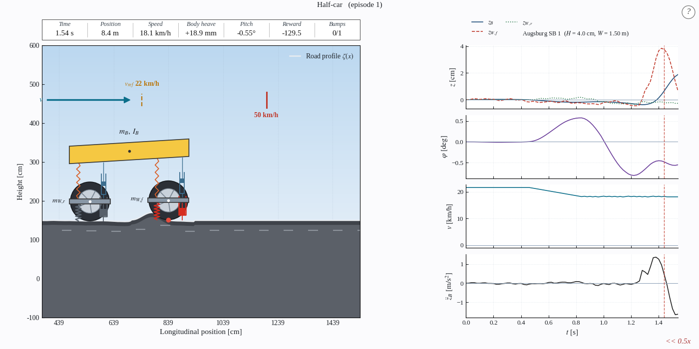

<h1 align="center">CALM</h1>

<b>Comfort-Aware Longitudinal Motion</b>

<i>Slow down for the bump, not for the sake of it.</i>

Every driver knows the moment. A speed bump comes up, you have half a second to decide, and the car answers with a jolt that should have been a ripple. CALM is an open research project about that decision: how a car can read the road ahead and ease off by exactly as much as the bump deserves, so the people inside barely notice it.

CALM began as a [bachelor thesis](https://doi.org/10.14279/depositonce-26841) at TU Berlin and has grown into an open source stack for comfort-aware speed planning. It contributes:

- **An open source software stack for comfort-aware speed planning over real speed bumps:** a half-car simulator with nonlinear suspension, a Gymnasium environment, an acados MPC, a PPO policy and ISO 2631-1 comfort scoring.
- **The CALM dataset:** 159 real bump crossings from [CARD](https://huggingface.co/CARD-Data) (114 Germany, 45 Italy; 105 usable), an extended real-time dataset for comfort.

  

The half-car simulator crossing a real speed bump.

## What you can find here

| Repository | What it is |
|---|---|
| [ride-models-matlab](https://github.com/CALM-Dataset/ride-models-matlab) | Quarter-car and half-car ride models for MATLAB and Simulink |
| [CALM](https://github.com/CALM-Dataset/CALM) | The simulator and the planners: the Gymnasium environment, the acados MPC, the PPO policy and the reactive driver |
| [CALM wiki](https://github.com/CALM-Dataset/CALM/wiki) | Documentation of the simulator, the vehicle models, the comfort metric, the planners and the dataset format |

## Models and data

The trained models and datasets are published on [Hugging Face](https://huggingface.co/CALM-Dataset) under the CALM-Dataset organization.

| Name | Type | Contents | Access |
|---|---|---|---|
| [CALM-PPO](https://huggingface.co/CALM-Dataset/CALM-PPO) | Model | The trained speed recommender and its five training runs | On request |
| [CALM-Scenarios](https://huggingface.co/datasets/CALM-Dataset/CALM-Scenarios) | Dataset | Road profiles and bump geometry of 159 real crossings | On request |
| [CALM-Germany](https://huggingface.co/datasets/CALM-Dataset/CALM-Germany) | Dataset | 114 crossings with camera, depth and sensor recordings | On request |
| [CALM-Italy](https://huggingface.co/datasets/CALM-Dataset/CALM-Italy) | Dataset | 45 crossings with camera, depth and sensor recordings | On request |

## Acknowledgments

The real-road recordings build on the [CARD dataset](https://huggingface.co/CARD-Data) ([Elazab et al., CVPR 2026](https://arxiv.org/abs/2605.05014)).
